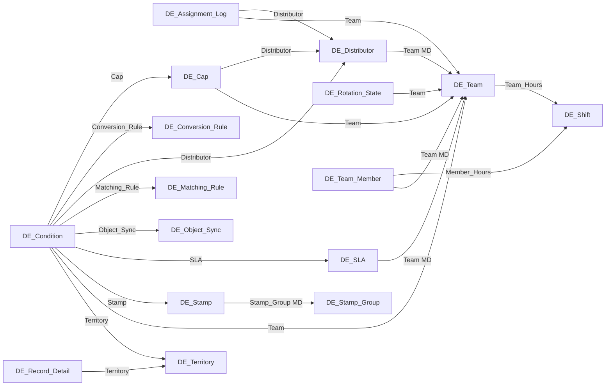

# Metadata Dependency Map

The dependencies between target components that implement the reference inventory, in the order they are built. Generated from the repository (object relationships, Apex references, LWC imports, report and dashboard references).

## 1. Objects → objects (relationship fields)

| Child object | Field | Parent | Kind |
|---|---|---|---|
| `DE_Agent__c` | `User__c` | `User` | lookup |
| `DE_Assignment_Log__c` | `Assigned_User__c` | `User` | lookup |
| `DE_Assignment_Log__c` | `Distributor__c` | `DE_Distributor__c` | lookup |
| `DE_Assignment_Log__c` | `Rejected_By__c` | `User` | lookup |
| `DE_Assignment_Log__c` | `Team__c` | `DE_Team__c` | lookup |
| `DE_Availability_Event__c` | `Changed_By__c` | `User` | lookup |
| `DE_Availability_Event__c` | `User__c` | `User` | lookup |
| `DE_Cap__c` | `Distributor__c` | `DE_Distributor__c` | lookup |
| `DE_Cap__c` | `Team__c` | `DE_Team__c` | lookup |
| `DE_Condition__c` | `Cap__c` | `DE_Cap__c` | lookup |
| `DE_Condition__c` | `Conversion_Rule__c` | `DE_Conversion_Rule__c` | lookup |
| `DE_Condition__c` | `Distributor__c` | `DE_Distributor__c` | lookup |
| `DE_Condition__c` | `Matching_Rule__c` | `DE_Matching_Rule__c` | lookup |
| `DE_Condition__c` | `Object_Sync__c` | `DE_Object_Sync__c` | lookup |
| `DE_Condition__c` | `SLA__c` | `DE_SLA__c` | lookup |
| `DE_Condition__c` | `Stamp__c` | `DE_Stamp__c` | lookup |
| `DE_Condition__c` | `Team__c` | `DE_Team__c` | lookup |
| `DE_Condition__c` | `Territory__c` | `DE_Territory__c` | lookup |
| `DE_Distributor__c` | `Team__c` | `DE_Team__c` | master-detail |
| `DE_Out_Of_Office__c` | `User__c` | `User` | lookup |
| `DE_Record_Detail__c` | `Matched_Account__c` | `Account` | lookup |
| `DE_Record_Detail__c` | `Matched_Contact__c` | `Contact` | lookup |
| `DE_Record_Detail__c` | `Matched_Lead__c` | `Lead` | lookup |
| `DE_Record_Detail__c` | `Territory__c` | `DE_Territory__c` | lookup |
| `DE_Rotation_State__c` | `Team__c` | `DE_Team__c` | lookup |
| `DE_SLA__c` | `Team__c` | `DE_Team__c` | master-detail |
| `DE_Stamp__c` | `Stamp_Group__c` | `DE_Stamp_Group__c` | master-detail |
| `DE_Team_Member__c` | `Member_Hours__c` | `DE_Shift__c` | lookup |
| `DE_Team_Member__c` | `Team__c` | `DE_Team__c` | master-detail |
| `DE_Team_Member__c` | `User__c` | `User` | lookup |
| `DE_Team__c` | `Team_Hours__c` | `DE_Shift__c` | lookup |

## 2. Objects → fields, layouts, list views, compact layouts, validation rules

| Object | Fields | Layouts | List views | Compact layouts | Validation rules |
|---|---|---|---|---|---|
| `Account` | 7 | 0 | 0 | 0 | 0 |
| `Case` | 15 | 0 | 0 | 0 | 0 |
| `Contact` | 7 | 0 | 0 | 0 | 0 |
| `DE_Agent__c` | 7 | 0 | 0 | 0 | 0 |
| `DE_Assignment_Event__e` | 6 | 0 | 0 | 0 | 0 |
| `DE_Assignment_Log__c` | 30 | 0 | 0 | 0 | 0 |
| `DE_Availability_Event__c` | 6 | 0 | 0 | 0 | 0 |
| `DE_Cap__c` | 9 | 0 | 0 | 0 | 2 |
| `DE_Condition__c` | 14 | 0 | 0 | 0 | 0 |
| `DE_Conversion_Rule__c` | 16 | 0 | 0 | 0 | 0 |
| `DE_Distributor__c` | 55 | 0 | 0 | 0 | 5 |
| `DE_Holiday__c` | 5 | 0 | 0 | 0 | 1 |
| `DE_Matching_Rule__c` | 13 | 0 | 0 | 0 | 0 |
| `DE_Object_Sync__c` | 5 | 0 | 0 | 0 | 0 |
| `DE_Out_Of_Office__c` | 7 | 0 | 0 | 0 | 2 |
| `DE_Record_Detail__c` | 20 | 0 | 0 | 0 | 0 |
| `DE_Rotation_State__c` | 7 | 0 | 0 | 0 | 0 |
| `DE_Run_Log__c` | 8 | 0 | 0 | 0 | 0 |
| `DE_SLA__c` | 10 | 0 | 0 | 0 | 2 |
| `DE_Settings__c` | 30 | 0 | 0 | 0 | 0 |
| `DE_Shift__c` | 3 | 0 | 0 | 0 | 0 |
| `DE_Stamp_Group__c` | 5 | 0 | 0 | 0 | 0 |
| `DE_Stamp__c` | 3 | 0 | 0 | 0 | 0 |
| `DE_Team_Member__c` | 8 | 0 | 0 | 0 | 2 |
| `DE_Team__c` | 37 | 0 | 0 | 0 | 0 |
| `DE_Territory__c` | 10 | 0 | 0 | 0 | 0 |
| `Lead` | 15 | 0 | 0 | 0 | 0 |
| `Opportunity` | 11 | 0 | 0 | 0 | 0 |

## 3. Apex → objects

| Class | Objects referenced |
|---|---|
| `DE_ActionTracking` | `DE_Assignment_Log__c`, `DE_Team__c` |
| `DE_AdminController` | `DE_Cap__c`, `DE_Condition__c`, `DE_Distributor__c`, `DE_Rotation_State__c`, `DE_SLA__c`, `DE_Shift__c`, `DE_Stamp_Group__c`, `DE_Team_Member__c`, `DE_Team__c` |
| `DE_AgentService` | `DE_Agent__c`, `DE_Availability_Event__c`, `DE_Team_Member__c` |
| `DE_Api` | `DE_Team_Member__c` |
| `DE_ArchiveService` | `DE_Distributor__c` |
| `DE_AssignmentWriter` | `DE_Assignment_Event__e`, `DE_Assignment_Log__c`, `DE_Distributor__c`, `DE_Record_Detail__c` |
| `DE_AvailabilityController` | `DE_Agent__c`, `DE_Availability_Event__c`, `DE_Holiday__c`, `DE_Out_Of_Office__c`, `DE_Shift__c`, `DE_Team_Member__c`, `DE_Team__c` |
| `DE_AvailabilityService` | `DE_Holiday__c`, `DE_Out_Of_Office__c` |
| `DE_CalendarSync` | `DE_Out_Of_Office__c` |
| `DE_CapService` | `DE_Assignment_Log__c`, `DE_Cap__c`, `DE_Condition__c` |
| `DE_ClassifierController` | `DE_Condition__c`, `DE_Conversion_Rule__c`, `DE_Matching_Rule__c`, `DE_Stamp_Group__c`, `DE_Stamp__c`, `DE_Territory__c` |
| `DE_ClassifierService` | `DE_Condition__c`, `DE_Conversion_Rule__c`, `DE_Matching_Rule__c`, `DE_Record_Detail__c`, `DE_Stamp_Group__c`, `DE_Territory__c` |
| `DE_Conditions` | `DE_Condition__c`, `DE_Record_Detail__c` |
| `DE_ConfigRepository` | `DE_Agent__c`, `DE_Cap__c`, `DE_Condition__c`, `DE_Distributor__c`, `DE_SLA__c`, `DE_Shift__c`, `DE_Team_Member__c`, `DE_Team__c` |
| `DE_ConfigTransfer` | `DE_Cap__c`, `DE_Condition__c`, `DE_Conversion_Rule__c`, `DE_Distributor__c`, `DE_Holiday__c`, `DE_Matching_Rule__c`, `DE_Object_Sync__c`, `DE_SLA__c`, `DE_Shift__c`, `DE_Stamp_Group__c`, `DE_Stamp__c`, `DE_Team_Member__c`, `DE_Team__c`, `DE_Territory__c` |
| `DE_ConfigValidator` | `DE_Cap__c`, `DE_Condition__c`, `DE_Distributor__c`, `DE_Object_Sync__c`, `DE_SLA__c`, `DE_Shift__c`, `DE_Team__c` |
| `DE_ConsoleController` | `DE_Assignment_Log__c`, `DE_Availability_Event__c`, `DE_Condition__c`, `DE_Distributor__c`, `DE_Object_Sync__c`, `DE_Record_Detail__c`, `DE_Run_Log__c` |
| `DE_DistributionCore` | `DE_Condition__c`, `DE_Record_Detail__c` |
| `DE_DistributionRunner` | `DE_Assignment_Log__c`, `DE_Record_Detail__c` |
| `DE_DynamicMembers` | `DE_Team_Member__c`, `DE_Team__c` |
| `DE_FlowActions` | `DE_Assignment_Log__c` |
| `DE_HealthChecker` | `DE_Run_Log__c` |
| `DE_LeadConversion` | `DE_Conversion_Rule__c`, `DE_Record_Detail__c` |
| `DE_LeadMatcher` | `DE_Matching_Rule__c`, `DE_Record_Detail__c` |
| `DE_MaintenanceBatch` | `DE_Assignment_Log__c`, `DE_Availability_Event__c`, `DE_Run_Log__c` |
| `DE_ManualAssignService` | `DE_Distributor__c` |
| `DE_Model` | `DE_Agent__c`, `DE_Cap__c`, `DE_Condition__c`, `DE_Distributor__c`, `DE_SLA__c`, `DE_Team_Member__c`, `DE_Team__c` |
| `DE_Notifier` | `DE_Assignment_Event__e` |
| `DE_ObjectSyncService` | `DE_Condition__c`, `DE_Object_Sync__c` |
| `DE_OwnerResolver` | `DE_Distributor__c`, `DE_Record_Detail__c` |
| `DE_Permissions` | `DE_Team__c` |
| `DE_PullService` | `DE_Distributor__c`, `DE_Record_Detail__c`, `DE_Team_Member__c` |
| `DE_RecordDetailController` | `DE_Assignment_Log__c`, `DE_Record_Detail__c` |
| `DE_RecordDetails` | `DE_Record_Detail__c` |
| `DE_RecordQuery` | `DE_Condition__c`, `DE_Distributor__c`, `DE_SLA__c`, `DE_Territory__c` |
| `DE_RejectionService` | `DE_Assignment_Event__e`, `DE_Assignment_Log__c`, `DE_Record_Detail__c` |
| `DE_RotationService` | `DE_Rotation_State__c`, `DE_Team__c` |
| `DE_RunLogger` | `DE_Run_Log__c` |
| `DE_Settings` | `DE_Settings__c` |
| `DE_SettingsController` | `DE_Settings__c` |
| `DE_ShiftCalendar` | `DE_Shift__c` |
| `DE_Simulator` | `DE_Record_Detail__c` |
| `DE_SlaService` | `DE_Assignment_Log__c`, `DE_Condition__c`, `DE_Record_Detail__c`, `DE_SLA__c` |
| `DE_StampClassifier` | `DE_Condition__c`, `DE_Record_Detail__c`, `DE_Stamp_Group__c`, `DE_Stamp__c` |
| `DE_StickyService` | `DE_Assignment_Log__c` |
| `DE_TeamLock` | `DE_Team__c` |
| `DE_TerritoryClassifier` | `DE_Record_Detail__c`, `DE_Territory__c` |
| `DE_TestFactory` | `DE_Condition__c`, `DE_Distributor__c`, `DE_Settings__c`, `DE_Team_Member__c`, `DE_Team__c` |
| `DE_TriggerDistribution` | `DE_Assignment_Log__c` |
| `DE_Ui` | `DE_Condition__c` |
| `DE_WidgetController` | `DE_Agent__c`, `DE_Assignment_Log__c`, `DE_Out_Of_Office__c`, `DE_Team_Member__c` |

## 4. Triggers → handlers

| Trigger | Object | Handler |
|---|---|---|
| `DE_AccountTrigger` | `Account` | `DE_TriggerHandler.handle` |
| `DE_CaseTrigger` | `Case` | `DE_TriggerHandler.handle` |
| `DE_ContactTrigger` | `Contact` | `DE_TriggerHandler.handle` |
| `DE_EventTrigger` | `Event` | `DE_TriggerHandler.handleActivities` |
| `DE_LeadTrigger` | `Lead` | `DE_TriggerHandler.handle` |
| `DE_OpportunityTrigger` | `Opportunity` | `DE_TriggerHandler.handle` |
| `DE_TaskTrigger` | `Task` | `DE_TriggerHandler.handleActivities` |

## 5. LWC → Apex and child components

| Component | Apex methods | Child components |
|---|---|---|
| `deAnalytics` | `DE_AdminController.getTeams`, `DE_ConsoleController.getAnalytics`, `DE_ConsoleController.getTeamPerformance` | — |
| `deAvailability` | `DE_AdminController.getTeams`, `DE_AdminController.getTimezoneOptions`, `DE_AvailabilityController.deleteHoliday`, `DE_AvailabilityController.deleteOutOfOffice`, `DE_AvailabilityController.deleteShift`, `DE_AvailabilityController.getCalendar`, `DE_AvailabilityController.getHolidays`, `DE_AvailabilityController.getOutOfOffice`, `DE_AvailabilityController.getRegions`, `DE_AvailabilityController.getRoster`, `DE_AvailabilityController.getShifts`, `DE_AvailabilityController.saveHoliday`, `DE_AvailabilityController.saveOutOfOffice`, `DE_AvailabilityController.saveShift`, `DE_AvailabilityController.setUsersOnline` | `c-de-record-picker` |
| `deClassifier` | `DE_AdminController.getObjectOptions`, `DE_ClassifierController.deleteConversionRule`, `DE_ClassifierController.deleteMatchingRule`, `DE_ClassifierController.deleteStamp`, `DE_ClassifierController.deleteStampGroup`, `DE_ClassifierController.deleteTerritory`, `DE_ClassifierController.getConversionRules`, `DE_ClassifierController.getMatchingRules`, `DE_ClassifierController.getStampGroups`, `DE_ClassifierController.getTerritories`, `DE_ClassifierController.importTerritories`, `DE_ClassifierController.reorderTerritories`, `DE_ClassifierController.runBackfill`, `DE_ClassifierController.saveConversionRule`, `DE_ClassifierController.saveMatchingRule`, `DE_ClassifierController.saveStamp`, `DE_ClassifierController.saveStampGroup`, `DE_ClassifierController.saveTerritory`, `DE_ClassifierController.setMapStatus` | `c-de-condition-builder`, `c-de-record-picker` |
| `deConditionBuilder` | `DE_AdminController.getFieldOptions` | — |
| `deConsole` | `DE_ConsoleController.getArchived`, `DE_ConsoleController.getMonitoring`, `DE_ConsoleController.getSources`, `DE_ConsoleController.getTodaysDistributions`, `DE_ConsoleController.restoreArchived`, `DE_ConsoleController.runHealthCheck`, `DE_ConsoleController.scheduleHealthChecker`, `DE_ConsoleController.startScheduler`, `DE_ConsoleController.stopScheduler` | `c-de-simulator` |
| `deDistributorEditor` | `DE_AdminController.saveDistributor` | `c-de-condition-builder`, `c-de-record-picker` |
| `deLogs` | `DE_ConsoleController.getLogTrace`, `DE_ConsoleController.getLogs`, `DE_ConsoleController.getRunLogs`, `DE_ConsoleController.retry`, `DE_ConsoleController.retryAll` | — |
| `deObjectSync` | `DE_ConsoleController.deleteSyncAction`, `DE_ConsoleController.getSyncActions`, `DE_ConsoleController.saveSyncAction` | `c-de-condition-builder` |
| `deRecordDetail` | `DE_RecordDetailController.assignManually`, `DE_RecordDetailController.distributeNow`, `DE_RecordDetailController.getManualOptions`, `DE_RecordDetailController.getRecordState`, `DE_RecordDetailController.reject` | `c-de-simulator` |
| `deRecordPicker` | `DE_AdminController.getOwnerNames`, `DE_AdminController.searchOwners` | — |
| `deSettings` | `DE_SettingsController.exportConfiguration`, `DE_SettingsController.getSettings`, `DE_SettingsController.importConfiguration`, `DE_SettingsController.saveSettings` | `c-de-record-picker` |
| `deSimulator` | `DE_ConsoleController.simulate` | — |
| `deTags` | `DE_AvailabilityController.cloneTags`, `DE_AvailabilityController.getTagAssignments`, `DE_AvailabilityController.getTagCollections`, `DE_AvailabilityController.saveTags` | — |
| `deTeamWorkspace` | `DE_AdminController.addMembers`, `DE_AdminController.cloneDistributor`, `DE_AdminController.deleteDistributor`, `DE_AdminController.getObjectOptions`, `DE_AdminController.getShiftOptions`, `DE_AdminController.getTeamDetail`, `DE_AdminController.removeMember`, `DE_AdminController.saveDistributorOrder`, `DE_AdminController.saveMembers`, `DE_AdminController.saveSlas`, `DE_AdminController.saveTeam`, `DE_AdminController.saveTeamCaps`, `DE_AdminController.setDistributorActive`, `DE_AdminController.setTeamActive`, `DE_AdminController.syncDynamicMembers`, `DE_AvailabilityController.setUsersOnline`, `DE_ConsoleController.getSourcePreview` | `c-de-condition-builder`, `c-de-distributor-editor`, `c-de-record-picker` |
| `deTeams` | `DE_AdminController.cloneTeam`, `DE_AdminController.deleteTeam`, `DE_AdminController.getDistributionViewer`, `DE_AdminController.getTeams`, `DE_AdminController.saveTeamOrder`, `DE_AdminController.setTeamActive` | `c-de-team-workspace` |
| `deUtils` | — | — |
| `deWidget` | `DE_WidgetController.createOutOfOffice`, `DE_WidgetController.getState`, `DE_WidgetController.pull`, `DE_WidgetController.reject`, `DE_WidgetController.toggle` | — |

## 6. Flows → objects and actions

| Flow | Object / trigger | Actions |
|---|---|---|

## 7. Reports → report types → objects; dashboards → reports

| Report | Report type |
|---|---|
| `DE_Distributions_by_Assignee` | `DE_Assignment_Logs__c` |
| `DE_Distributions_by_Day` | `DE_Assignment_Logs__c` |
| `DE_Distributions_by_Team` | `DE_Assignment_Logs__c` |
| `DE_Rejections_by_Day` | `DE_Assignment_Logs__c` |
| `DE_Run_History` | `DE_Run_Logs__c` |
| `DE_SLA_Alerts` | `DE_Assignment_Logs__c` |
| `DE_Speed_to_Assign` | `DE_Assignment_Logs__c` |
| `DE_Time_to_Action` | `DE_Assignment_Logs__c` |
| `DE_User_Availability_History` | `DE_Availability_Events__c` |

| Report type | Base object |
|---|---|
| `DE_Assignment_Logs` | `DE_Assignment_Log__c` |
| `DE_Availability_Events` | `DE_Availability_Event__c` |
| `DE_Run_Logs` | `DE_Run_Log__c` |

| Dashboard | Reports |
|---|---|
| `DE_Distribution_Engine_Overview` | `DE_Reports/DE_Distributions_by_Assignee`, `DE_Reports/DE_Distributions_by_Day`, `DE_Reports/DE_Distributions_by_Team`, `DE_Reports/DE_Rejections_by_Day`, `DE_Reports/DE_Run_History`, `DE_Reports/DE_SLA_Alerts`, `DE_Reports/DE_Speed_to_Assign` |

## 8. Permission sets → objects, classes, tabs, custom permissions

| Permission set | Objects | Fields | Apex classes | Tabs | Custom permissions |
|---|---|---|---|---|---|
| `DE_Adm` | 22 | 310 | 12 | 11 | DE_Admin |
| `DE_System_Manag` | 22 | 310 | 12 | 11 | DE_System_Manager |
| `DE_Team_Manag` | 22 | 310 | 11 | 7 | DE_Team_Manager |
| `DE_Us` | 17 | 266 | 6 | 1 | DE_User |

## 9. Build order

1. Custom settings (`DE_Settings__c`), custom permissions, platform event, platform cache partition.
2. Parent objects: `DE_Holiday_Region__c`, `DE_Shift__c`, `DE_Team__c`, `DE_Persona__c`, `DE_Stamp_Group__c`, `DE_Territory__c`, `DE_Matching_Rule__c`, `DE_Conversion_Rule__c`.
3. Child objects: members, managers, distributors, SLAs, caps, conditions, shift plans and blocks, stamps, holidays.
4. Runtime and log objects: rotation state, record details, assignment logs and log actions, reject requests, history, classifier and sync logs, run logs.
5. Fields on standard objects (Lead, Case, Opportunity, Contact, Account).
6. Apex: utilities → repository/model → services → engine → controllers → API/flow actions → jobs; then triggers.
7. LWC: utilities → building blocks → tabs and global components.
8. Email templates → workflow email alerts → flows.
9. Layouts, compact layouts, list views, tabs, flexipages, app.
10. Report types → reports → dashboards; permission sets last.
